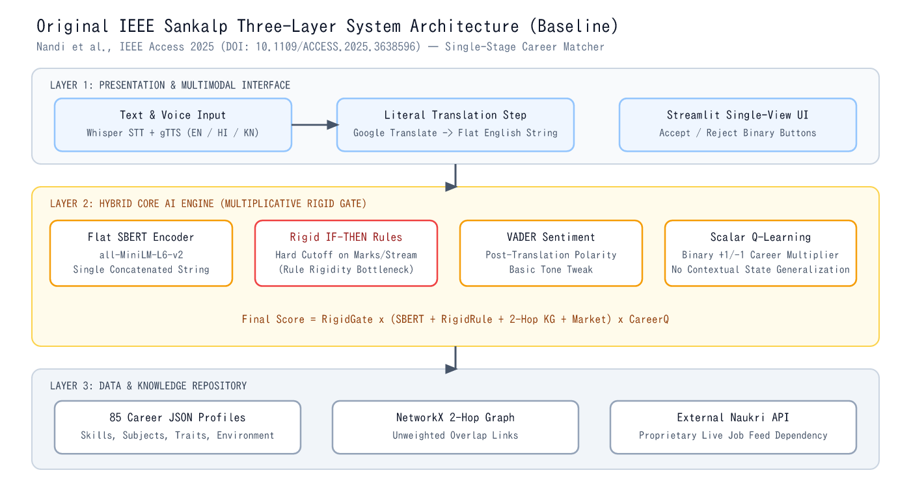

# IEEE Research Paper Analysis: *Sankalp: AI-Powered Career Guidance System*

- **Paper Title**: *Sankalp: AI-Powered Career Guidance System*
- **Authors**: Somesh Nandi, B. S. Preethi, M. S. Shashidhara, and co-authors (RV College of Engineering, Bengaluru)
- **Publication Venue**: *IEEE Access*, Vol. 13, 2025
- **DOI**: `https://doi.org/10.1109/ACCESS.2025.3638596`

---

## 1. Problem Statement (Why Sankalp Was Needed)

In India, millions of students make high-stakes education and career choices under family pressure, urban-centric coaching bias, or incomplete information. Existing career guidance approaches suffer from four fundamental gaps:

1. **Human Counselor Scarcity**: India faces an acute student-to-counselor deficit, especially in Tier-2, Tier-3, and rural schools.
2. **Rigid Psychometric Tests**: Traditional rule-based aptitude portals use static questionnaires and hard percentage cutoffs. If a student misses an arbitrary cutoff by 1–2% or describes an interdisciplinary passion in their own words, rigid rules reject viable careers.
3. **Pure Black-Box Chatbots**: Unconstrained generative LLM chatbots lack structured academic eligibility checks, produce non-deterministic advice, and do not adapt systematically from structured user feedback.
4. **Language & Accessibility Barriers**: Most digital career tools operate only in English text, excluding regional-language speakers (such as Hindi and Kannada students) and first-generation learners who prefer voice interaction.

---

## 2. Theoretical Foundations in the Paper

Unlike ad-hoc portals, the Sankalp paper grounds its AI design in two established vocational psychology theories:

1. **Holland's RIASEC Theory of Vocational Personalities**: Models person-environment fit across six dimensions — *Realistic (R)*, *Investigative (I)*, *Artistic (A)*, *Social (S)*, *Enterprising (E)*, and *Conventional (C)*.
2. **Social Cognitive Career Theory (SCCT)**: Emphasizes how **self-efficacy beliefs**, emotional anxiety/confidence, and perceived barriers shape career choices — motivating Sankalp's integration of VADER sentiment analysis for empathetic guidance.

---

## 3. Original Sankalp Three-Layer System Architecture

The paper organizes Sankalp into three horizontal layers:

1. **Presentation & Multimodal Layer**:
   - Supports **Text** and **Voice** input across **English**, **Hindi**, and **Kannada**.
   - Uses Speech-to-Text (Whisper STT) and Text-to-Speech (gTTS), passing non-English text through a translation step into English before downstream NLP.
2. **Hybrid Core AI Engine (Multi-Agent Layer)**:
   - Combines five computational modules: **Sentence-BERT (SBERT)** semantic matching, **Deterministic Rule-Based Reasoning**, **VADER Sentiment Analysis**, **Q-Learning Adaptive Feedback**, and **Sector/Market Alignment**.
3. **Data & Knowledge Graph Layer**:
   - Stores a curated JSON career repository (**85 career categories**, **510 unique keywords**, **58,100 characters**), a **NetworkX Knowledge Graph** linking careers via shared skills/subjects/traits, and session logs in SQLite.

---

## 4. Step-by-Step Explanation of the Paper's Core Modules

### 4.1 Sentence-BERT (SBERT) Semantic Similarity (`Algorithm 2`)
- **Model**: Pre-trained `all-MiniLM-L6-v2` transformer producing **384-dimensional** dense sentence embeddings.
- **How It Works**: Concatenates the student's skills, interests, and preferred subjects into a single query string $u$, encodes each career's description and attributes into a single vector $c_i$, and computes cosine similarity:
  $$\text{Sim}(u, c_i) = \frac{\mathbf{e}_u \cdot \mathbf{e}_{c_i}}{\|\mathbf{e}_u\| \, \|\mathbf{e}_{c_i}\|}$$
- **Why Better Than Keyword Search**: Recognizes that *"building neural networks in Python"* is semantically close to *AI & Machine Learning Engineer* even if exact keywords differ.

### 4.2 Deterministic Rule-Based Reasoning Engine
- **How It Works**: Applies explicit `IF-THEN` rules over stream eligibility, required subjects, and minimum academic score cutoffs (`minAcademicScore`).
- **Role**: Prevents semantically similar but academically ineligible recommendations (for example, recommending MBBS without Biology).

### 4.3 Q-Learning Reinforcement Learning (`Algorithm 3`)
- **Hyperparameters Reported in Paper (Section V-B2)**:
  - Learning rate $\alpha = 0.1$
  - Discount factor $\gamma = 0.9$
  - Exploration rate $\varepsilon$ decaying linearly from $1.0 \to 0.1$ over $100$ epochs
- **Update Rule**:
  $$Q(s, a) \leftarrow Q(s, a) + \alpha \left[ R + \gamma \max_{a'} Q(s', a') - Q(s, a) \right]$$
- **Feedback Loop**: When a student clicks **Accept** ($R = +1$) or **Reject** ($R = -1$), the career's Q-multiplier is updated and rejected careers are filtered out.

### 4.4 VADER Sentiment Analysis
- Computes compound emotional polarity $\in [-1, +1]$ on student reflections.
- Detects student anxiety or low confidence (SCCT) so the interface responds with encouraging, supportive framing rather than cold rejection.

### 4.5 Multilingual Processing (English, Hindi, Kannada)
- Accepts regional language input, translates it into English, runs the English SBERT + VADER pipeline, and presents localized output.

### 4.6 Knowledge Graph Explainability
- Builds a graph connecting **Careers**, **Skills**, **Subjects**, and **Personality Traits**.
- Uses **2-hop traversal ("neighbors-of-neighbors")** to explain *why* a career matched and suggest adjacent *Plan-B* careers sharing foundational skills.

---

## 5. Dataset & Experimental Results Reported in the Paper

- **Evaluation Dataset**: Private **160-profile Curated Ground Truth (CGT)** dataset collected during RVCE student workshops, annotated by career counselors across **85 career categories**.
- **Paper's Reported Accuracy (`Table 5` of IEEE Paper)**:
  - **Rule-Only**: `52.5%` Top-1 Hit Rate · `74.0%` Top-3 Hit Rate · `3.60 / 5.0` User Satisfaction
  - **SBERT-Only**: `64.4%` Top-1 Hit Rate · `86.0%` Top-3 Hit Rate · `4.10 / 5.0` User Satisfaction
  - **Hybrid Base (Rule + SBERT)**: `68.1%` Top-1 Hit Rate · `88.5%` Top-3 Hit Rate · `4.35 / 5.0` User Satisfaction
  - **Full Sankalp**: `77.5%` Top-1 Hit Rate · `90.5%` Top-3 Hit Rate (`95% CI: [88.1%, 92.9%]`) · `4.71 / 5.0` User Satisfaction
- **Paper's Reported Latency**:
  - Core AI recommendation engine: `350 ms` (`180–200 ms` text-only interaction; `1,250 ms` end-to-end voice interaction).

---

## 6. Key Limitations Identified in the Original Paper

Careful reading of **Section VII-A (Limitations)**, **Algorithm 2**, and **Algorithm 3** reveals five concrete limitations that motivate our **Improved Sankalp** project:

1. **Rule-Model Rigidity (Explicitly Noted in Section VII-A)**: Hard step-function cutoffs penalize students who miss an academic threshold by 1–5% or come from lateral NEP-2020 streams (e.g., Polytechnic Diploma $\to$ B.Tech, Commerce+Math $\to$ Analytics).
2. **Flat Single-String SBERT Dilution & Incomplete-Profile Fragility**: Concatenating all fields into one string causes missing fields (blank skills or omitted marks) to degrade cosine similarity and trigger punitive rule defaults.
3. **Translation-Induced Semantic & Emotional Loss in Hindi/Kannada**: Literal pre-translation strips Indian educational idioms (*SSLC, PUC, डिप्लोमा, ಸೌರಶಕ್ತಿ*) and neutralizes native emotional anxiety markers before VADER runs.
4. **Scalar Context-Free Q-Learning**: Binary $+1/-1$ scalar updates on individual career IDs memorize training-set career popularity rather than learning a generalizable fusion policy across unseen careers.
5. **Single-Stage Job Matching Without Education-to-Career Pathways**: The original paper treats career selection as a flat one-shot jump rather than modeling India's multi-stage progression (`After 10th -> After 12th -> Undergraduate -> Graduate`).
