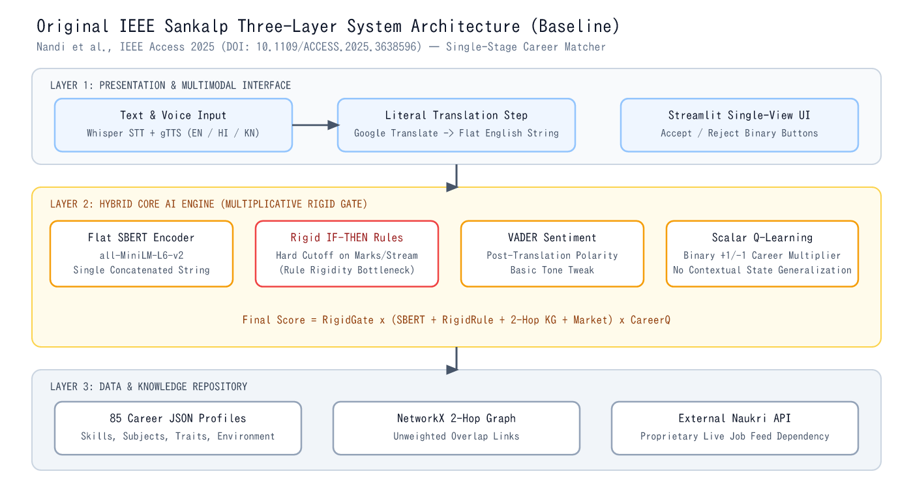
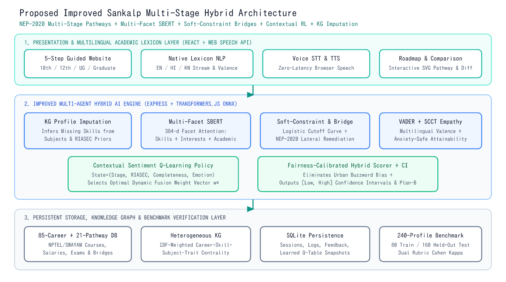

# Architectural & Algorithmic Comparison: Original IEEE Sankalp vs. Proposed Improved Sankalp

This document provides a direct, module-by-module comparison between:
1. **Legacy EduPath Navigator** (initial repository baseline),
2. **Original IEEE Sankalp** (*IEEE Access* 2025, `DOI: 10.1109/ACCESS.2025.3638596`), and
3. **Improved Sankalp** (our redesigned and experimentally validated system).

---

## 1. Comprehensive System Comparison Matrix

| Dimension | Legacy EduPath Navigator | Original IEEE Sankalp Paper | Proposed Improved Sankalp |
| :--- | :--- | :--- | :--- |
| **Primary Guidance Scope** | Scattered widgets (quizzes, college maps, EMI calculators, parent zone) | Single-stage career matching across 85 career categories | **End-to-end 5-step NEP-2020 education-to-career website** (`After 10th`, `After 12th`, `UG`, `Graduate`) across **85 careers & 21 pathways** |
| **Semantic NLP Model** | Cloud LLM prompt wrapper (Genkit Gemini API) | Pre-trained `all-MiniLM-L6-v2` on a single flat concatenated string | **Multi-Facet Attention `all-MiniLM-L6-v2` (384-d ONNX)** encoding *Skills*, *Interests*, and *Academic* facets independently |
| **Rule-Based Reasoning** | Static stream lookup dictionaries | Rigid boolean IF-THEN cutoffs (causes Section VII-A *Rule Rigidity*) | **Soft Fuzzy-Constraint Logistic Curves + NEP-2020 Lateral Stream Bridges + 6-D Holland RIASEC Cosine Fit** |
| **Incomplete Profile Handling** | Fails or returns generic fallback list | Penalizes missing marks/skills via multiplicative rule gate | **Conditional Bipartite Knowledge-Graph Imputation** + non-punitive Bayesian mark prior + Confidence Intervals `[Low, High]` |
| **Reinforcement Learning** | None | Scalar binary $+1/-1$ Q-multiplier per career ID | **Contextual Sentiment-Augmented Bellman Policy** over `(Stage, RIASEC, Completeness, Emotion)` selecting optimal fusion weights $\mathbf{w}^*$ |
| **Emotion & SCCT Module** | None | Post-translation English VADER polarity | **VADER + Native Hindi/Kannada Emotional Valence Lexicon + SCCT Supportive Attainability Adjustment** |
| **Multilingual Processing** | Partial UI labels only | Literal Google Translate $\to$ English string | **Native Indian Academic & Career Stem Lexicon (`EN`, `HI`, `KN`)** preserving regional stream & trade concepts + Web Speech STT/TTS |
| **Knowledge Graph** | Static flow JSON | Unweighted 2-hop NetworkX graph | **IDF-Weighted Heterogeneous Career–Skill–Subject–Trait Graph** + interactive SVG subgraph & Plan-B visualizer |
| **Fairness & Bias Control** | Not evaluated | Mentioned only as future ethical consideration | **Calibrated Rural/Semi-Urban Fairness Scoring** + quantitative Demographic Parity auditing |
| **Course & Career Roadmap** | Basic static course list | Career description + live Naukri feed | **4-Stage Milestone Roadmap, Skill-Gap Checklist, NPTEL/SWAYAM Courses & Multi-Career Comparison Matrix** |
| **Persistence & Reproducibility** | External Firebase cloud lock-in | Local SQLite + private unreleased CGT dataset | **Zero-config SQLite (`better-sqlite3` WAL) + Reproducible 240-Profile Stratified Open Benchmark (`npm run evaluate`)** |

---

## 2. Visual Comparison of System Architectures

### Original IEEE Sankalp Architecture

### Proposed Improved Sankalp Architecture

---

## 3. Why Every Original Sankalp Module Was Preserved as Our Scientific Baseline

In accordance with **Phase 3**, we **did not** discard the IEEE paper's methodology in favor of an unrelated black-box LLM:
- Both `Original Sankalp` (`modelVariant = 'original_sankalp'`) and `Improved Sankalp` (`modelVariant = 'improved_sankalp'`) execute inside the exact same TypeScript codebase (`src/engine/hybridRecommender.ts`) using the exact same `Xenova/all-MiniLM-L6-v2` transformer weights and 85-career knowledge base.
- Every recommendation card in Step 4 displays **Improved Sankalp Score** alongside **Original Baseline Score** in real time, and users can click **"Compare All 4 Models Live"** to inspect `Rule-Only`, `SBERT-Only`, `Original Sankalp`, and `Improved Sankalp` rankings side-by-side on any custom student profile.
