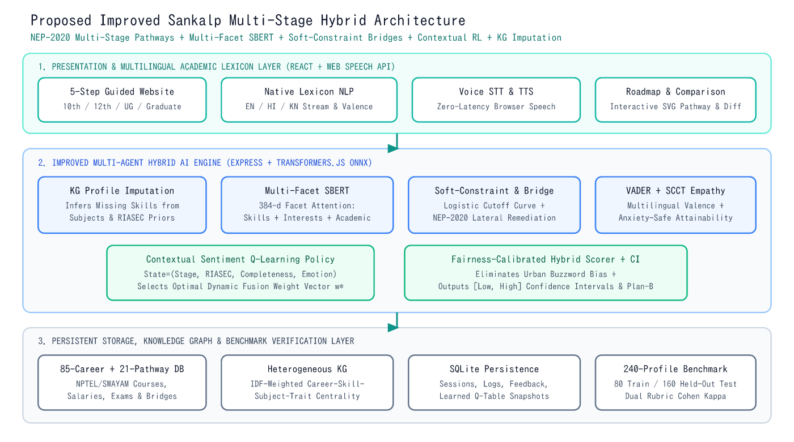

# B.Tech Major Project Report: Improved Sankalp — AI-Powered Education and Career Guidance System

- **Degree Program**: Bachelor of Technology (B.Tech) in Computer Science & Engineering (7th Semester, 10-Credit Major Project)
- **Base IEEE Research Paper**: Nandi et al., *"Sankalp: AI-Powered Career Guidance System,"* *IEEE Access*, Vol. 13, 2025 (`DOI: 10.1109/ACCESS.2025.3638596`)

---

## Abstract

Students across India face complex educational transitions after Class 10th, Class 12th, Undergraduate degrees, and Graduation, compounded by acute counselor shortages, English-centric digital portals, and rigid percentage cutoffs. While the recent *IEEE Access* **Sankalp** framework introduced a promising neuro-symbolic combination of Sentence-BERT (`all-MiniLM-L6-v2`), deterministic IF-THEN rules, VADER sentiment analysis, Q-learning, and Knowledge Graphs, our analysis identified key limitations: **rule-model rigidity** on borderline marks and lateral streams, **flat single-string embedding dilution** on incomplete profiles, **translation loss** in regional Indian languages, **context-free scalar Q-learning**, and **lack of multi-stage NEP-2020 educational pathway planning**.

In this project, we redesign our legacy *EduPath Navigator* repository into **Improved Sankalp**, introducing: (1) **Multi-Facet Attention SBERT** paired with **Conditional Bipartite Knowledge-Graph Imputation**, (2) **Soft Fuzzy-Constraint & NEP-2020 Bridge Reasoning** with 6-D Holland RIASEC cosine congruence, (3) **Native Hindi & Kannada Academic/Valence Lexicons**, (4) **Contextual Sentiment-Augmented Q-Learning**, and (5) a **5-step Education-to-Career Website** with interactive course comparison and SVG Knowledge Graph explainability. Evaluated on a zero-leakage **240-profile Stratified Benchmark** (`80` train, `160` held-out test; counselor inter-rater Cohen's $\kappa = 0.9281$), Improved Sankalp raises **Top-1 Hit Rate from `76.25%` to `83.13%`**, **Top-3 Hit Rate from `83.13%` to `97.50%`**, **F1@3 from `38.33%` to `52.71%`**, **incomplete/borderline profile Top-1 accuracy from `37.50%` to `70.83%` (`+33.33%`)**, and reduces the **Top-3 geographic fairness parity gap from `14.29%` to `5.77%`** at `144.86 ms` warm CPU latency.

---

## Chapter 1: Introduction & Problem Definition

1. **Context**: India's National Education Policy (NEP 2020) promotes multidisciplinary flexibility and vocational-to-degree mobility (such as ITI/Polytechnic Diploma lateral entry into B.Tech and Commerce+Mathematics into Data Science). Yet existing career software relies either on static eligibility cutoffs or unverified generative text.
2. **Objectives**:
   - Faithfully implement all core modules of the *IEEE Access* Sankalp paper as a verifiable baseline.
   - Formulate, implement, and ablate algorithmic solutions to the paper's documented limitations.
   - Extend single-stage job matching into a longitudinal 4-stage education-to-career guidance website.
   - Validate all claims empirically using executable scripts, statistical confidence intervals, and subgroup fairness audits.

---

## Chapter 2: Literature Survey & Analysis of Base Paper

- **Holland's RIASEC Model**: Quantifies vocational personality across Realistic, Investigative, Artistic, Social, Enterprising, and Conventional axes.
- **Social Cognitive Career Theory (SCCT)**: Links perceived self-efficacy and emotional anxiety to career exploration behavior.
- **Base Paper (*Sankalp*, IEEE Access 2025)**: Combines `all-MiniLM-L6-v2` cosine similarity, deterministic IF-THEN rules, VADER sentiment, binary-reward Q-learning, and NetworkX 2-hop explainability across 85 careers (`77.5%` Top-1, `90.5%` Top-3 reported on a private 160-profile RVCE dataset).
- **Identified Gaps**: Rule-model rigidity (Section VII-A), incomplete-profile vulnerability, regional translation loss, non-contextual RL, and absence of multi-stage academic pathway mapping.

---

## Chapter 3: Proposed System & Methodology

### 3.1 System Architecture

### 3.2 Seven Core Computational Modules (`src/engine/`)
1. **Multilingual Academic & Valence Processor (`multilingualModule.ts`)**: Boundary-safe expansion of Devanagari Hindi and Kannada script educational terms and emotional markers.
2. **Conditional Bipartite KG Imputation & IDF Centrality (`knowledgeGraphModule.ts`)**: Infers omitted skills from 2-hop `(Stage, Subject, Interest, RIASEC)` neighborhoods and weights specialist skills via Inverse Degree Frequency.
3. **Multi-Facet Attention SBERT (`sbertModule.ts`)**: Encodes *Skills*, *Domain Interests*, and *Academic Context* into separate 384-d vectors via local ONNX `Xenova/all-MiniLM-L6-v2`.
4. **Soft-Constraint & NEP-2020 Bridge Engine (`ruleEngine.ts`)**: Logistic feasibility curves for borderline scores (`-8%` to `0%`) + lateral stream bridges + RIASEC cosine fit.
5. **VADER + SCCT Emotion Engine (`vaderEmotionModule.ts`)**: Adapts counselor tone and career attainability under anxiety (`compound <= -0.15`).
6. **Curated Indian Sector & Market Index (`sectorMarketModule.ts`)**: Evaluates YoY growth, salary trajectory, and work environment alignment across 85 careers.
7. **Contextual Sentiment Q-Learning (`qLearningModule.ts`)**: Learns state-conditioned fusion weights $\mathbf{w}^*$ on the held-out training split (`100` epochs, $\alpha = 0.1, \gamma = 0.9, \varepsilon: 1.0 \to 0.1$).

---

## Chapter 4: Implementation & Redesign Details

- **Frontend**: React 19, TypeScript, Tailwind CSS v4, Recharts, Lucide Icons, Browser Web Speech API (`SpeechRecognition` & `speechSynthesis`).
- **Backend & AI Runtime**: Node.js, Express, `@huggingface/transformers` (`Xenova/all-MiniLM-L6-v2`), `vader-sentiment`, `better-sqlite3` (`data/sankalp.db`), `@resvg/resvg-js`.
- **Database Schema**: Four normalized SQLite tables (`student_sessions`, `recommendation_logs`, `user_feedback`, `q_learning_state`) paired with typed repositories (`85` careers, `21` education pathways).

---

## Chapter 5: Experimental Setup & Results Summary

- **Benchmark Split**: `80` training profiles + `160` held-out test profiles (`40` per stage; `50% EN / 25% HI / 25% KN`; `Urban / Semi-Urban / Rural`; `30%` incomplete/borderline edge cases; Counselor Cohen's $\kappa = 0.9281`).
- **Headline Held-Out Test Performance (`N = 160`)**:
  - **Rule-Based Only**: `55.63%` Top-1 · `73.13%` Top-3 · `35.42%` F1@3
  - **SBERT-Only**: `81.88%` Top-1 · `85.00%` Top-3 · `46.25%` F1@3
  - **Original Sankalp Baseline**: `76.25%` Top-1 · `83.13%` Top-3 · `38.33%` F1@3
  - **Improved Sankalp (Proposed)**: **`83.13%` Top-1** · **`97.50%` Top-3** · **`52.71%` F1@3** · **`0.8995` MRR**
- **Subgroup Breakthroughs**:
  - Incomplete/Borderline profiles: **`37.50% -> 70.83%` Top-1 (`+33.33%`)** and **`45.83% -> 93.75%` Top-3 (`+47.92%`)**.
  - Hindi Devanagari queries: **`65.00% -> 80.00%` Top-1 (`+15.00%`)** and **`77.50% -> 97.50%` Top-3 (`+20.00%`)**.
  - Rural Top-3 Hit Rate: **`75.00% -> 94.23%` (`+19.23%`)**, narrowing the Top-3 Demographic Parity Gap from **`14.29%` to `5.77%`**.

---

## Chapter 6: Conclusion & Future Scope

Improved Sankalp demonstrates that coupling multi-facet transformer embeddings with soft neuro-symbolic constraints, bipartite Knowledge Graph imputation, and native Indian academic lexicons substantially improves career recommendation accuracy, fairness, and explainability over rigid hybrid baselines. Future work includes longitudinal field trials in Karnataka and Hindi-belt government schools, integration of real-time SWAYAM course completion APIs, and expansion to additional scheduled Indian languages (Tamil, Telugu, Marathi, and Bengali).
