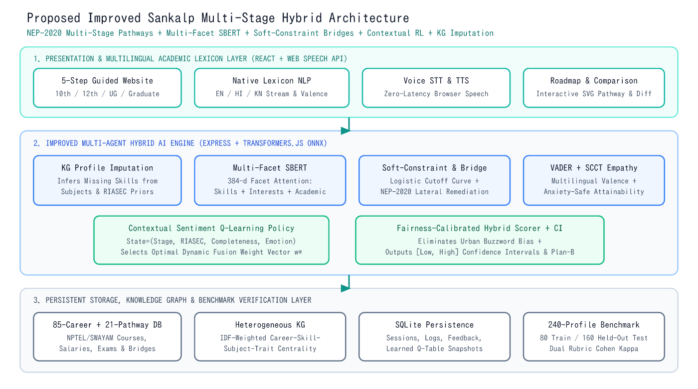
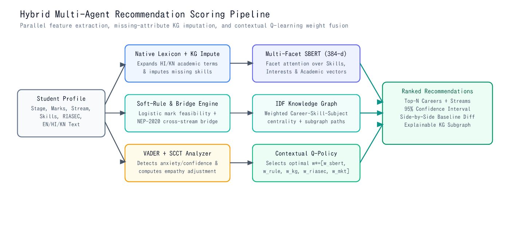
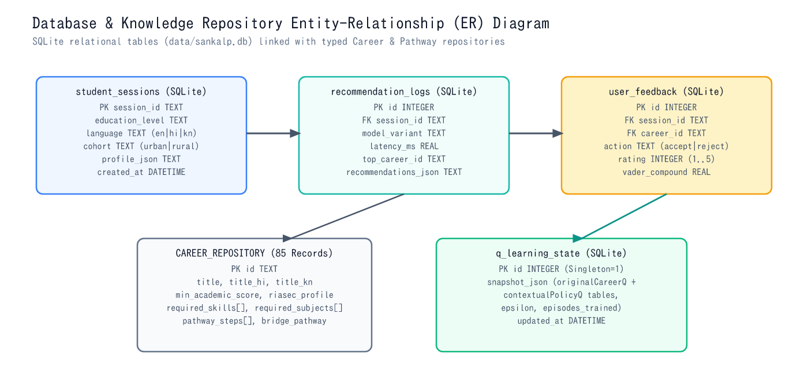
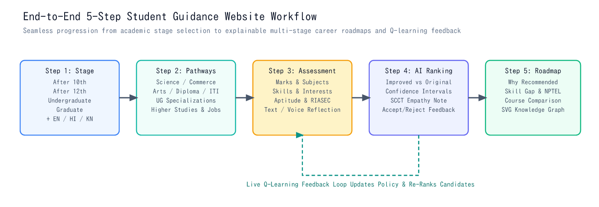
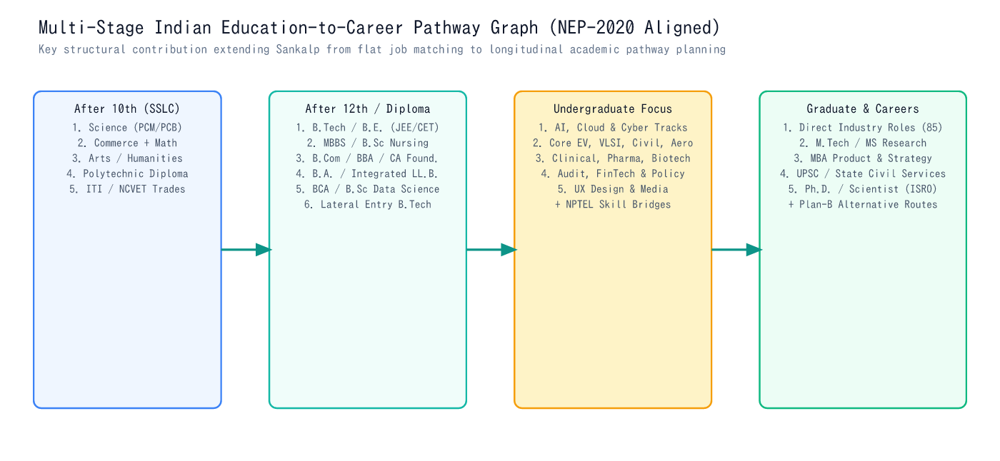

# System Architecture: Improved Sankalp

## 1. Architectural Redesign From Legacy EduPath Navigator

To convert the legacy **EduPath Navigator** prototype into a rigorous research implementation of **Improved Sankalp**, we performed a clean architectural overhaul:

| Legacy EduPath Navigator Component | Action Taken | Engineering & Research Rationale |
| :--- | :--- | :--- |
| Parent Zone (`/parent-zone/*`), EMI/Loan Calculators, Scholarship Marketing Pages | **Removed** | Unrelated to the IEEE Sankalp research objectives; diluted student assessment focus. |
| Leaflet College Map & Exam Notification Widgets | **Removed** | Static informational clutter with no hybrid recommendation or empirical evaluation value. |
| `DreamWall` & `DailyQuickWins` Gamification Cards | **Removed** | Replaced by scientifically grounded VADER + SCCT emotion-aware guidance and Q-learning feedback. |
| Paid Black-Box Genkit LLM Prompts (`personalized-career-recommendations.ts`) | **Replaced** | Replaced by deterministic, reproducible local `Xenova/all-MiniLM-L6-v2` SBERT embeddings + Soft-Rule + KG + Contextual Q-Learning. |
| Indian Stream Taxonomy, RIASEC Quiz Concepts & Course Comparison | **Retained & Upgraded** | Expanded into an **85-career**, **21-pathway** NEP-2020 multi-stage repository (`After 10th`, `After 12th`, `UG`, `Graduate`). |

---

## 2. Three-Layer Multi-Agent System Architecture

Improved Sankalp preserves the three-layer conceptual clarity of the IEEE paper while upgrading every internal computational agent:

### Layer 1: Presentation & Multilingual Academic Interface (`React 19 + TypeScript + Tailwind CSS`)
- **Website-First Academic Layout**: Structured around a 5-step guided student journey, a live Research & Benchmarks Lab, and an Architecture & Documentation Hub.
- **Multilingual Text & Voice Modality**: Supports **English (`en-IN`)**, **Hindi (`hi-IN`)**, and **Kannada (`kn-IN`)** via native browser `SpeechRecognition` (STT) and `speechSynthesis` (TTS) with zero external cloud latency.

### Layer 2: Improved Hybrid Core AI Engine (`Express + Node.js + Transformers.js ONNX`)
Composed of seven modular, independently testable TypeScript engines inside `src/engine/`:

1. **`multilingualModule.ts`**: Preserves regional academic terms (*PUC, SSLC, डिप्लोमा, अभियांत्रिकी, ಗಣಿತ, ವಿಜ್ಞಾನ, ಸೌರಶಕ್ತಿ*) and native Hindi/Kannada sentiment valence markers before embedding.
2. **`knowledgeGraphModule.ts`**: Constructs a heterogeneous **Career–Skill–Subject–Trait** bipartite graph with Inverse-Degree-Frequency (IDF) edge weights and performs **Conditional Bipartite Imputation** when a student leaves skills or marks blank.
3. **`sbertModule.ts`**: Runs real **`Xenova/all-MiniLM-L6-v2`** (384-dimensional ONNX transformer) across three semantic facets (*Skills Facet*, *Domain Interests Facet*, and *Academic Context Facet*) with dynamic confidence weighting.
4. **`ruleEngine.ts`**: Implements both the **Original Rigid Rule Engine** (baseline) and our **Improved Soft-Constraint & NEP-2020 Bridge Engine** using smooth logistic cutoff curves and lateral stream bridges.
5. **`vaderEmotionModule.ts`**: Combines `vader-sentiment` polarity with native multilingual valence deltas and Social Cognitive Career Theory (SCCT) supportive attainability adjustments.
6. **`sectorMarketModule.ts`**: Scores alignment against curated Indian labour-market growth rates, salary progression, and work-environment preferences (replacing brittle proprietary Naukri API scraping).
7. **`qLearningModule.ts` & `hybridRecommender.ts`**: Implements both the paper's scalar career Q-multiplier and our **Contextual Sentiment-Augmented Q-Learning Policy**, which selects optimal fusion weights $\mathbf{w}^* = [w_{\text{sbert}}, w_{\text{rule}}, w_{\text{kg}}, w_{\text{riasec}}, w_{\text{market}}]$ conditioned on `Stage × DominantRIASEC × Completeness × Emotion`.

### Layer 3: Persistent Data & Benchmark Verification Layer (`SQLite + Typed Repositories`)
- **`data/sankalp.db` (`better-sqlite3` in WAL mode)**: Stores `student_sessions`, `recommendation_logs`, `user_feedback`, and `q_learning_state` snapshots locally across restarts on both Windows and Linux.
- **`src/data/careerRepository.ts` & `educationPathways.ts`**: 85 structured careers + 21 multi-stage education pathways with NPTEL/SWAYAM courses, entrance exams, and bridge routes.

---

## 3. End-to-End 5-Step Student Guidance Workflow

1. **Step 1 (Select Education Stage)**: Student chooses `After 10th`, `After 12th`, `Undergraduate`, or `Graduate`, plus language (`EN`/`HI`/`KN`) and geographic context (`Urban`/`Semi-Urban`/`Rural`).
2. **Step 2 (Explore Education Pathways)**: Displays stage-appropriate streams and courses (e.g., Science, Commerce, Arts, Polytechnic Diploma, and ITI after 10th; stream-filtered Engineering, Medical, Commerce, Arts, Pure Science, and Computing after 12th).
3. **Step 3 (Holistic Student Assessment)**: Captures academic marks (or intentional blank mode), preferred subjects, skills, interests, 5-axis aptitude, 6-axis Holland RIASEC profile, and free-form multilingual voice/text aspirations.
4. **Step 4 (Explainable AI Recommendations)**: Presents ranked education tracks and careers with **Improved vs. Original Sankalp scores**, 95% confidence intervals, factor bars, SCCT empathy notes, live 4-model comparison, and **Accept/Reject Q-learning feedback**.
5. **Step 5 (Personalized Career Roadmap & Knowledge Graph)**: Renders longitudinal stage milestones, skill-gap checklists, NPTEL/SWAYAM course links, a multi-career comparison table, and an interactive **SVG Knowledge Graph subgraph**.

